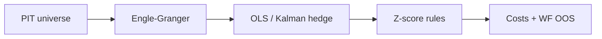

# Statistical Arbitrage within Dynamic Markets

Classical **pairs statistical arbitrage** for crypto (extensible to other assets):  
**cointegration → hedge ratio (OLS / Kalman) → residual spread → z-score → dollar-neutral book**, with explicit costs and walk-forward validation.

This is **not** a cross-sectional rank momentum engine.

| | |
|---|---|
| **Author** | Michael Washington |
| **Status** | P0 MVP + Kalman hedge |
| **License** | MIT |

## Highlights (synthetic walk-forward demo)

Reproducible seed `42` — see [`Research/initial-results.md`](Research/initial-results.md):

| Hedge | Net Sharpe | Net CAGR | BTC β | \|β\|≤0.25 |
|---|---:|---:|---:|---:|
| OLS | **1.36** | **15.4%** | −0.006 | 100% |
| Kalman | 0.17 | 1.1% | −0.014 | 100% |

Costs: 5 bps fee + 2 bps slippage / side. Pre-cost OLS Sharpe **1.50**.



## Quick start

```bash
python -m venv .venv && source .venv/bin/activate
pip install -e ".[dev]"
pytest
python -m stat_arb.cli --hedge both --seed 42
```

## Repository layout

```text
src/stat_arb/
  data/           # schema, PIT universe, adapters (synthetic, Binance public)
  cointegration/  # Engle–Granger + pair screen
  hedge/          # OLS + Kalman
  signals/        # z-score entry/exit/stop
  portfolio/      # dollar-neutral weights, BTC β monitor
  costs/          # bps + funding
  backtest/       # engine, walk-forward, metrics
Research/         # architecture, design decisions, initial results
tests/            # pytest (α/β, hygiene, ablation, no look-ahead)
```

## Research docs

- [`Research/architecture.md`](Research/architecture.md) — diagrams + code map  
- [`Research/design-decisions.md`](Research/design-decisions.md) — why these choices  
- [`Research/initial-results.md`](Research/initial-results.md) — demo metrics highlight  
- [`Research/artifacts/demo_walkforward_results.json`](Research/artifacts/demo_walkforward_results.json)

## Design constraints (airtight)

- Point-in-time universe; **no stables as legs**
- No `bfill` in research paths; capped `ffill`
- Signals lagged (`execution_lag=1`); no same-bar fills
- Parameters / pairs frozen before each OOS fold
- CAPM α/β unit-tested against a toy series
- Pre-cost and post-cost metrics always reported

## Binance public data

`BinancePublicKlinesAdapter` uses public REST klines only (no API keys on argv) and caches CSV under `data/cache/binance/`.

```python
from stat_arb.data.adapters import BinancePublicKlinesAdapter
adapter = BinancePublicKlinesAdapter(cache_dir="data/cache/binance")
bars = adapter.get_bars(["BTCUSDT", "ETHUSDT"], "2023-01-01", "2024-01-01", freq="1d")
```

## Disclaimer

Research software only. Synthetic demo results are not a promise of live performance. No live capital path in P0.
