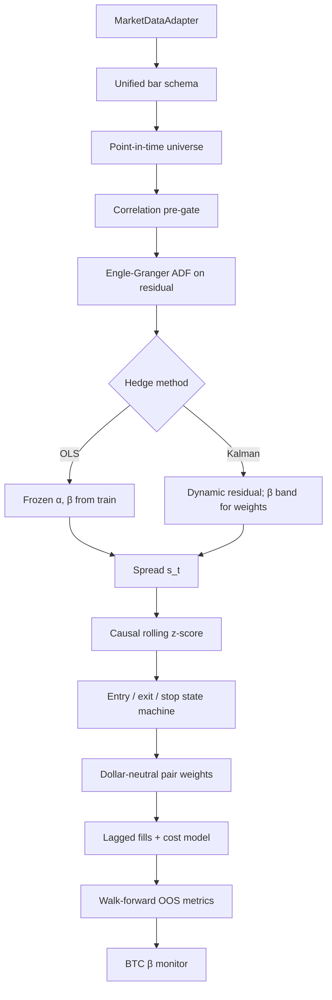

# Architecture Overview

**Project:** Statistical Arbitrage within Dynamic Markets  
**Scope:** P0 true stat-arb MVP **plus Kalman hedge** (first-class, not deferred)

This codebase implements classical pairs statistical arbitrage — **not** cross-sectional rank momentum. The claim path is:

```text
point-in-time universe → Engle–Granger screen → hedge (OLS | Kalman)
  → residual spread → z-score rules → dollar-neutral book
  → cost model → walk-forward metrics (incl. CAPM α/β)
```

## System diagram



## Package map (code references)

| Concern | Path |
|---|---|
| Config / frozen defaults | [`src/stat_arb/config.py`](../src/stat_arb/config.py) |
| Bar schema (no `bfill`) | [`src/stat_arb/data/schema.py`](../src/stat_arb/data/schema.py) |
| Adapter interface | [`src/stat_arb/data/adapters/base.py`](../src/stat_arb/data/adapters/base.py) |
| Synthetic crypto panel | [`src/stat_arb/data/adapters/synthetic.py`](../src/stat_arb/data/adapters/synthetic.py) |
| Binance public klines + CSV cache | [`src/stat_arb/data/adapters/binance.py`](../src/stat_arb/data/adapters/binance.py) |
| PIT universe (no stables) | [`src/stat_arb/data/universe.py`](../src/stat_arb/data/universe.py) |
| Engle–Granger | [`src/stat_arb/cointegration/engle_granger.py`](../src/stat_arb/cointegration/engle_granger.py) |
| Pair screen + β sanity | [`src/stat_arb/cointegration/screening.py`](../src/stat_arb/cointegration/screening.py) |
| OLS hedge | [`src/stat_arb/hedge/ols.py`](../src/stat_arb/hedge/ols.py) |
| Kalman hedge | [`src/stat_arb/hedge/kalman.py`](../src/stat_arb/hedge/kalman.py) |
| Z-score rules | [`src/stat_arb/signals/zscore.py`](../src/stat_arb/signals/zscore.py) |
| Dollar-neutral weights | [`src/stat_arb/portfolio/pairs.py`](../src/stat_arb/portfolio/pairs.py) |
| BTC β monitor | [`src/stat_arb/portfolio/beta.py`](../src/stat_arb/portfolio/beta.py) |
| Costs (bps + funding) | [`src/stat_arb/costs/model.py`](../src/stat_arb/costs/model.py) |
| Backtest engine | [`src/stat_arb/backtest/engine.py`](../src/stat_arb/backtest/engine.py) |
| Walk-forward harness | [`src/stat_arb/backtest/walkforward.py`](../src/stat_arb/backtest/walkforward.py) |
| CAPM α/β metrics | [`src/stat_arb/backtest/metrics.py`](../src/stat_arb/backtest/metrics.py) |
| Demo CLI | [`src/stat_arb/cli.py`](../src/stat_arb/cli.py) |

## Data flow detail

1. **Adapter** returns long-form bars: `timestamp, instrument_id, OHLCV, optional funding`.
2. **Universe** at as-of \(t\) uses trailing ADV$, listing age, zero-volume fraction, min price; **stables excluded as legs**.
3. **Screen** on train window only: return correlation pre-gate → log-price Engle–Granger → ADF p-value + \|β\| band + price-scale ratio.
4. **Trade** on OOS with parameters/pairs **frozen**; z-score rolling stats are causal; fills use `execution_lag=1`.
5. **Report** pre-cost and post-cost equity metrics side by side; CAPM vs BTC with unit-tested formulas.

## Explicit non-goals (P0)

- Johansen baskets, paper-trading gateway, equities adapter (P1)
- Capacity / participation studies (P2)
- Live capital
